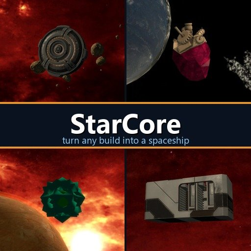
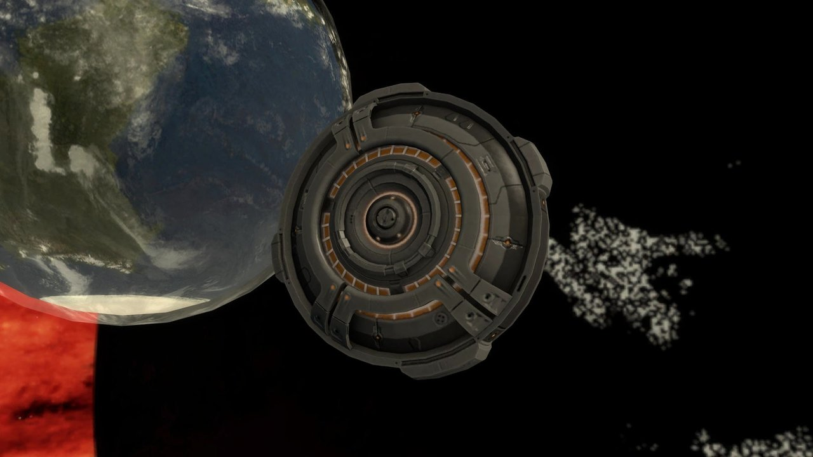
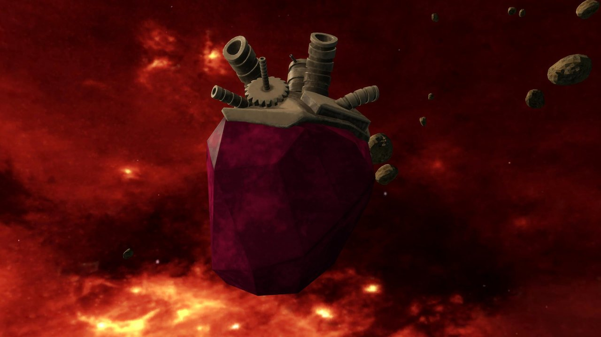
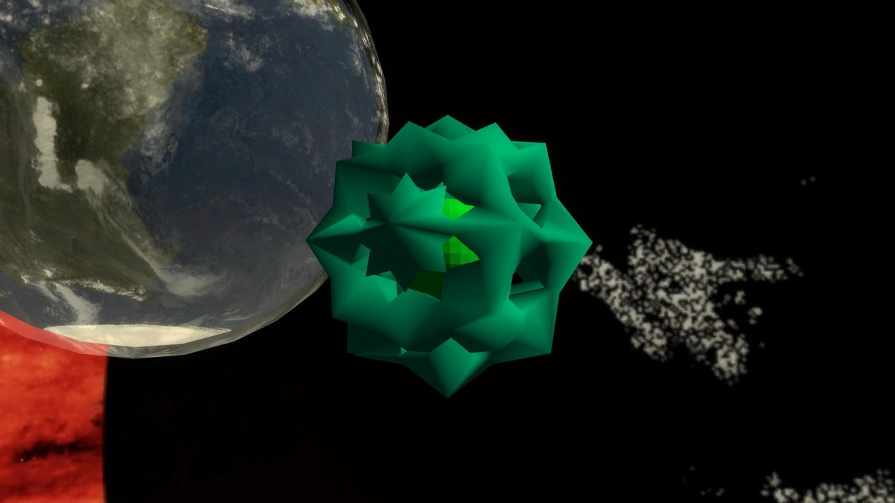
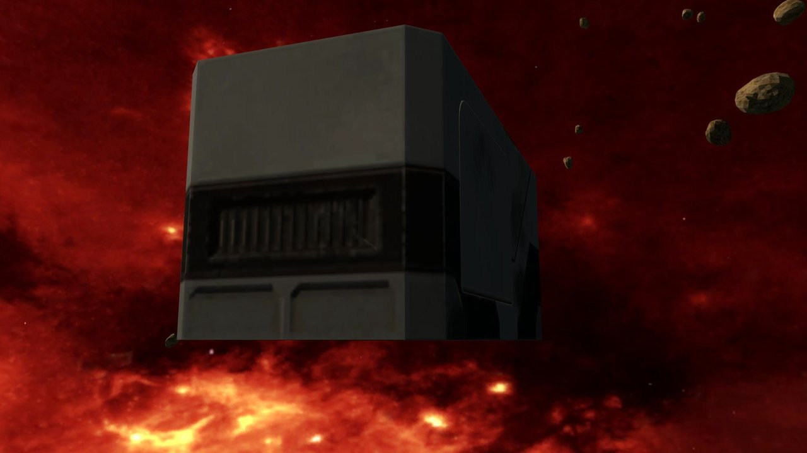
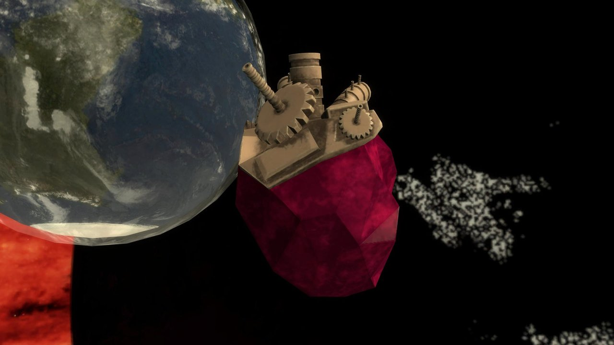
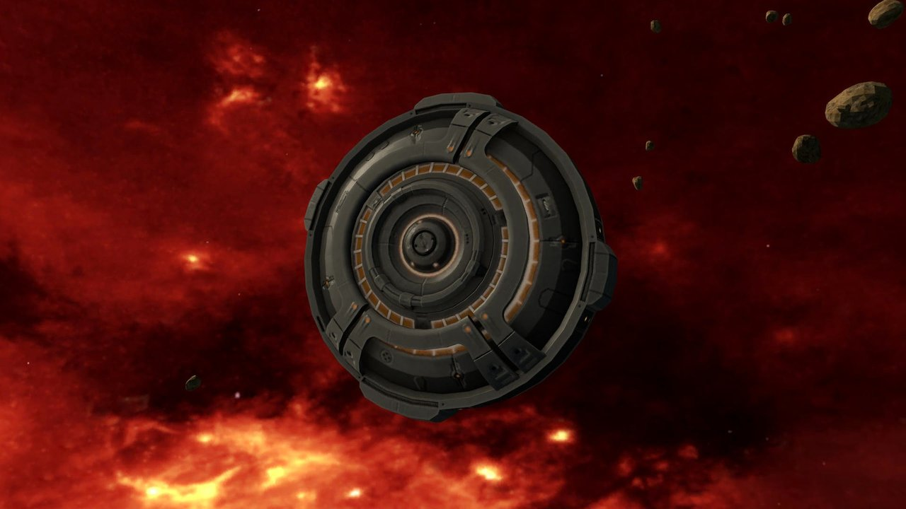
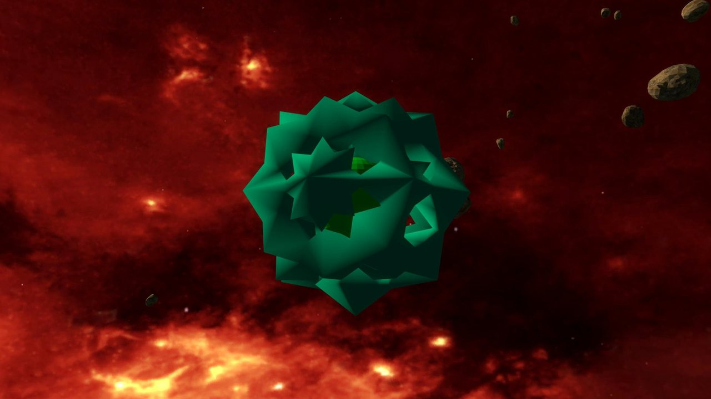

# StarCore - Ship System

> Build anything. Put a core in it. Fly it.

StarCore turns whatever you built into a real spaceship. Weld one core to your build, sit down, and it flies: hover, jump through hyperspace, raise shields, fire your guns. No E2, no wiring, no setup - the core finds the ship by itself.

## Install
**Steam Workshop (easiest):** subscribe [there](https://steamcommunity.com/sharedfiles/filedetails/?id=3840678974).

**By hand:** download `starcore-1.0.0.zip` from [Releases](../../releases/latest) and unpack it into
`garrysmod/addons/` (you get the folder `garrysmod/addons/starcore`).

## Bugs, problems and wishes
Please use [Issues](../../issues): pick *Bug report* or *Wish or idea*. On the Steam Workshop page the comments work too.

## Pictures

---

## What's inside

### Flight
- Hover, height lock, WASD, turn, climb and dive, boost - or steer with the mouse
- Walk around the bridge while the ship flies: nobody slides off
- Autopilot: fly to a point or follow a target, climbing over obstacles on the way
- Hyperspace jumps to saved marks or coordinates, with safety checks before every jump, and three jump effects to choose from

### Combat and crew
- Radar with friend and foe, auto-defence, aim with lead for any Wire weapon that has a Fire input (CAP turrets, cannons, rail guns, Wire turrets)
- Shields, cloak, tractor beam, self-destruct
- Crew seats: pilot, gunner, engineer, passenger. Hull points from the ship's mass, repair tool, engineers repair on board
- Owner, crew and friends are never targeted

### Stargate tie-in
With Ascension Gates (or CAP, CAP Enhanced, EAP): the ship's own gate and iris, dialling from the helm, auto-iris, jump to a gate, and Asgard beaming with the ship's transporter.

### Looks and comfort
- 12 core designs in four families: reactor, crystal, alien and military - swap a placed core's look whenever the ship is landed
- Pilot HUD and ship screens with true speed and height, in your own units (metres, feet or game units)
- One window for everything, which stays open while you fly
- Wire inputs and outputs for E2 fans

---

## Required
Nothing. StarCore works alone.
- **PowerGrid** (or Spacebuild): jumps and systems use the ship's real energy
- **Ascension Gates** (or CAP / EAP): Stargate and transporter features
- [Wiremod](https://steamcommunity.com/sharedfiles/filedetails/?id=160250458): weapons and E2 control

All our addons in one click: [Ascension Gates - Complete](https://steamcommunity.com/sharedfiles/filedetails/?id=3840681489)

## First flight
1. Build something with a seat. Freeze it.
2. Take the **StarCore** tool and left click your build: a core sits there, welded on.
3. Sit in the seat. Space lifts off, Ctrl goes down, WASD flies, Shift boosts.
4. Press R for the ship window: helm, jumps, weapons, systems, crew.

## Privacy
StarCore collects nothing and never goes online on its own. The Workshop, GitHub and tip buttons in its menu only open a page when you click them.

---

## Fuel for the hyperdrive
> Hyperspace is free. Building the hyperdrive took a lot of coffee.

If StarCore got your ship off the ground, a small tip helps the next one take off: [paypal.me/soulridejourney](https://www.paypal.me/soulridejourney)
Never needed, always appreciated. A thumbs-up and a favourite help a lot too.

---

## Licence
StarCore's code is MIT. The core models are works of Sketchfab artists under CC BY 4.0 - authors, titles and links are in the game (Settings > Credits) and inside the addon (lua/starcore/sh_license.lua).
